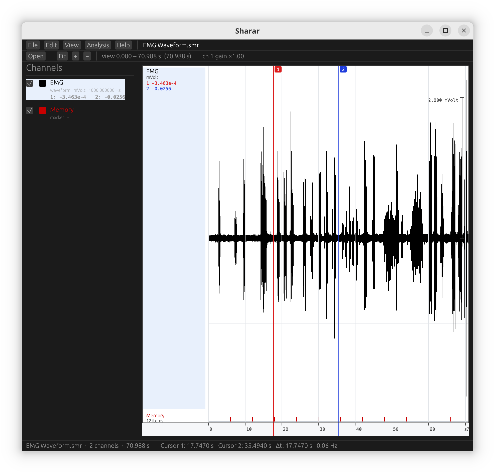

# Sharar

An application to read CED Spike2 `.smr` and `.smrx` files.

Sharar opens a recording from CED's Spike2 (the acquisition program Spike2 ships with the
1401 interface) and displays it: waveform channels, event channels and markers on a shared
time axis, with cursors, per-channel gain and scale bars. It is written in Rust with egui and
reads the files directly rather than through CED's Windows DLLs. It builds on Linux, macOS and
Windows, and has been developed and tested on Linux.



## Build and run

```sh
cargo run -p sharar -- path/to/recording.smr   # or .smrx
```

Command-line flags: `--dc` starts with DC remove on, `--filters` opens the filter dialog,
`--lowpass=<hz>` applies a FIR low pass at startup, `--average` opens the average dialog with
a result computed, `--export` writes the visible window to CSV and reports the path, and
`--record` opens the live strip chart on its synthetic source. The other flags in
`app/src/main.rs` (`--chan-info`, `--yaxis`, `--yrange=<lo>,<hi>`, `--showhide`, `--copy-dump`,
`--bands=notch`, `--bands=kill`, `--bands-apply`, `--process`, `--process-chain`,
`--two-views`, `--views-check`) are development switches. `--run-script=<file.s2s> [data file]` runs a script without a window (starting in the data file, if one is named), prints its log and exits (0 if it finished); `--script=<file.s2s>` opens the window and runs one. Each opens one dialog or state at
startup, and `--copy-dump` prints Edit → Copy's text and exits.

Pass a file on the command line, or use `File → Open…` or the toolbar's Open button. Both show
the system file picker, filtered to `.smr` and `.smrx`. `File → Open by path…` takes a typed
path instead.

The menu bar carries Spike2's nine menus. The contents are not yet Spike2's 188 items:
`docs/gui.md` records the menu inventory recovered from `SONVIEW.exe` and lists what is
missing and in what order it is worth adding, and `docs/dialogs.md` does the same for the
175 dialog templates — including what Spike2's FIR dialog offers that this one does not.

Keyboard: `F` fits the recording to the window, `+`/`-` change the selected channel's gain,
`0` resets it, `D` toggles DC remove on the selected channel. Mouse: wheel zooms about the
pointer, middle-drag pans, dragging near a cursor moves it.

## What works

- Reads SON-format `.smr` files: file header, up to 32 channel headers, chained data blocks.
- Reads 64-bit `.smrx` files (Spike2 8 and later): header stream, string table, channel
  records and the per-channel index tree. The format is picked from the file's first bytes.
  Waveform and event channels are checked against CED's `sonpy`; see "Notes on the format".
- Waveform channels (16-bit ADC and 32-bit float), drawn as a min/max envelope so a
  12,000-sample trace reads correctly in 500 pixels.
- Event and marker channels drawn as tick rows; marker codes shown as characters and text
  marks shown as their label.
- Waveform-mark channels (spike trains with a snippet per event): tick raster plus the mean
  snippet, e.g. 646 spikes of 100 points each.
- Two draggable cursors, with the value at each cursor shown per channel and `Δt` and its
  reciprocal in the status bar.
- Per-channel vertical gain, an automatic amplitude fit, a labelled scale bar, grid and zero
  line.
- Channel list with visibility toggles and selection, and `View → Channel Information…`, the
  read-out Spike2 gives for the selected channel: title, comment, kind, units, rate, scale,
  offset, waveform range and item count.
- Measurements between the cursors: sample count, mean, RMS, minimum, maximum and
  peak-to-peak per waveform channel, computed on the processed signal.
- DC remove (a centred boxcar mean subtraction) per channel, off by default: the Analysis
  menu's `DC remove on selected channel` checkbox, or `D`, or `--dc` on the command line.
- Peri-stimulus average: `Analysis → Average around events…` picks an event channel and a
  window, then plots the mean waveform with the trial count.
- CSV export of the selected channel over the visible window: `File → Export channel…`,
  or `--export` on the command line.
- Scripts: `Script → Run Script…` compiles and runs a `.s2s` with the port's own interpreter on a worker thread and shows `Print` output in a log window you can cancel. A script starts in the file on screen: `MaxTime`, `ChanTitle$`, `NextTime` and the rest answer about it, and what it does to the view — channels shown or hidden, the cursors, the time range, the selected channel — is applied to the window when it ends. The language is complete and checked against Spike2; commands are ported a family at a time (strings, maths, arrays and formatting, and the file and channel queries are), and a script that reaches one that is not stops there and says which.
- Live strip chart: `--record` opens a scrolling view of the last five seconds, one trace per
  channel, fed by a synthetic source until the 1401 path is wired.
- Digital filters: `Analysis → Digital filters…` applies a low pass, high pass, band pass or
  band stop to the selected channel. The FIR path is a port of Spike2's own designer: the Parks-McClellan
  exchange in `Filters.dll`, with the band table, the tap count and the defaults that
  `FIRWin.s2l` builds for `FIRQuick`. You give it a corner frequency, a transition width and
  the stop-band attenuation in dB, exactly as Spike2 does, and it derives the coefficient
  count from them. Coefficients agree with CED's own library on thirty designs: twenty-six to
  1e-14 relative or better, and four warped band tables to between 2e-12 and 8.6e-8; `docs/filters.md` records the recovered code and how it was checked.
  The dialog plots the response over 0 to Nyquist as you change the parameters, through
  `CFIR::FreqR`, the same evaluator Spike2's dialog uses, and it edits CFIR's band table
  directly — edges with a wanted gain, weights derived the way Spike2 derives them — so a
  hand-built table designs with the original's numbers and applies with CED's own
  convolution. The IIR option is a two-pole
  Butterworth section, causal, and is not Spike2's; it covers only the low and high pass.

## What is not built yet

This is an early slice of a large program, not a finished replacement for Spike2.

| Area | State |
|---|---|
| Acquisition from a CED 1401 | `--record` opens a live strip chart fed by a synthetic source; the 1401 backend is a stub that reports no device attached. The userspace half of the stack is recovered and `docs/1401.md` records it, but the device-level protocol is still inside the driver and no capture of it exists |
| Sampling configuration | none |
| Channel processing | DC remove and FIR filters (low pass, high pass, band pass, band stop) in a per-channel process chain under `Analysis → Process…`; no rectification, integration or other processes |
| Averaging | peri-stimulus average works; no smoothing, confidence bands or baselines |
| Spike sorting | wavemarks load and plot, but there is no sorting or unit separation |
| `.s2s` scripting | the language is ported: a parser, a compiler checked word for word against Spike2's (87 scripts, and 34,259 generated calls to the 503 built-ins, none differ), and an interpreter checked by running programs inside Spike2 and comparing results bit for bit (162 programs agree, with zero tolerance). Ported commands: strings, maths (the C library's functions and Spike2's special functions are translated from the vendor's code and agree to the last bit), arrays (`ArrFFT`, `ArrFilt`, `ArrConv`, `ArrSpline`, `ArrStats`, `ArrHist` and the rest run Spike2's own code), `Str$`/`Print`/`Print$` (with the Microsoft C runtime's `printf`), and on a data view `FileOpen`, `FileClose`, `View`, `MaxTime`, the `Chan*` queries, `NextTime`, `LastTime`, `Count`, `ChanData`, `ChanValue`, `MinMax`, the sampling-setting commands (`SampleRepeats`, `SampleLimitTime`, `SampleUsPerTime`, `SampleChannels` …, which run on SONVIEW's own configuration object), the waveform processing settings (`ChanProcessAdd`, `ChanProcessArg`, `ChanProcessInfo`, `ChanProcessClear`), the cursor commands (all `HCursor*`, `CursorActive*`, `CursorSearch`), the serial commands, `Profile` and the signal-conditioner commands (`Cond*`), the colour tables (`Colour`, `ColourGet`, `PaletteGet` …) and the IIR filter bank (`IIRCreate`, `IIRInfo`, `IIRName$`, `IIRComment$`, on the real `CIIRFilterBank` from `Filters.dll`), `ChanMeasure`, `ChanSearch` and `ChanValue` (all their modes, run by SONVIEW's own measuring, search and interpolation routines on stand-in channel objects; checked on every channel of every example recording), the cursor commands (`CursorX`, `CursorVisible`, `CursorLabel`, `CursorRenumber` …), `ViewFind`, `Error$` (through SONVIEW's own message handler), `InStrRE`, and the display switches (`XAxis`, `Grid`, `ChanNumbers` …). Commands not written by hand run Spike2's own machine code (the `s2lift` crate, translated from its DLLs, including the data-file engine) where the window services it asks for exist; see `docs/script.md`. Not ported: the other ~400 commands (views and windows, cursors, drawing, dialogs, channel processing, file and serial I/O, sampling), and error messages with line numbers |
| Writing `.smr` | read-only; CSV export works |
| `.smrx` (SON64) | waveform and event channels verified against `sonpy`. Marker, text-mark, wave-mark and `RealWave` channels, recordings with pauses, files with several header blocks and three-level index trees are implemented from the layout but not checked against a real file |
| Filter design | the Parks-McClellan designer behind `FIRQuick` and `FIRMake`, so low/high pass, band pass and band stop coefficients match Spike2 to 1.8e-14 or better, as do the antisymmetric types 5 and 6 that only `FIRMake` can reach; band tables that stop short of Nyquist take the same warped path and agree to between 2e-12 and 8.6e-8 relative; the dialog offers the four symmetric types, and the differentiator is library-only; the IIR option is not Spike2's |

## Layout

```
s2lift/   Spike2's script-engine DLLs translated to Rust (generated by tools/lift*.py) with a machine model checked against the CPU
smr/      .smr and .smrx reader, the FIR designer, the script parser and compiler — no dependencies
app/      the egui/eframe application
tools/    inventory.py (.smr reference reader), smrx_oracle.py (.smrx check against sonpy),
          fir_oracle.py (filter check against CED's Filters.dll), compile_oracle.py
          (script compiler check against CED's compiler.dll) and compile_cases/, the
          scripts both compilers are given; command_table.py (reads the built-in command
          table out of runtime.s2l), lift.py and lift_runtime.py (the translator), run_oracle.py and run_cases/ (programs run inside Spike2 and compared bit for bit), libm_fuzz.py and util_fuzz.py (maths checked against the vendor's), call_oracle.py (checks calls to them against the vendor's
          compiler) and compile_oracle.c, the harness both oracles run, oracle/ (runs a script inside Spike2 itself)
docs/     screenshot; gui.md and dialogs.md on the menus and dialogs, filters.md on the
          recovered designer, script.md on the script engine and its command table,
          1401.md on the acquisition stack
```

```sh
cargo test     # reader, filter designer and script tests
```

The tests check the reader against known values from CED's own example recordings: channel
inventories, sample rates, units, event counts and durations. Those recordings ship on the
Spike2 CD and are not redistributed here, so those tests skip when they are absent — extract
`data2.cab` from the CD to `testdata/` to run them fully. The parser is also covered by a
synthetic `.smr` fixture that the test helper writes itself, so scaling, block indexing and
markers are tested on a machine without the CD. A second fixture, `smr/tests/synthetic_smrx.rs`,
does the same for `.smrx`. The script compiler is checked the same way:
`tools/compile_oracle.py` runs Spike2's own compiler over every file in
`tools/compile_cases` and writes the words it produced to
`testdata/compile_reference.txt`; the test skips when that fixture is absent. It covers the index tree, a deleted channel slot, a stale data
block and truncated files. `tools/smrx_oracle.py` compares the `.smrx` reader with `sonpy` on
real recordings (see "Notes on the format").

## Checked against Spike2

The layout and menus were checked against Spike2 rather than the manual alone. Its data
window carries a numeric y-axis per channel and a status bar reading `cursor, time, value`.
Its menus are File, Edit, View, Analysis, Cursor, Sample, Script, Window, Help.

`tools/vm.sh` drives a Windows guest over libvirt and the QEMU guest agent to do that. It is
a development aid, not part of the build, and needs your own guest with Spike2 installed, its
libvirt domain in `DOM`, and `LIBVIRT_DEFAULT_URI=qemu:///session`.

## Notes on the format

For `.smr`, recovered by reading the files and cross-checking against `neo.rawio.Spike2RawIO`.
The Pascal-string and reserved-header notes apply only to the 32-bit layout. The `.smrx`
notes follow in their own section.


- Channel titles, comments and units are **Pascal strings** (length byte first), not
  NUL-terminated C strings.
- Files reserve 32 channel headers and mark unused ones `kind = 0`; they must be filtered or
  the channel list is mostly empty slots.
- Filters follow the arrangement the CD's manual describes: the FIR type is set by a pass
  band edge and a transition gap, and the number of coefficients follows from the narrower of
  the bands.
- ADC samples convert to units as `count * scale / 6553.6 + offset`. `scale` is in units per
  volt and a 16-bit ADC spans ±5 V, so a channel's full-scale range is `scale * 5`. Spike2
  reports that range in its channel information, and `neo` uses the same divisor. An earlier
  version of this reader divided by 65536 and read every value ten times too small.
- The EMG example's "Memory" marker channel holds twelve markers every 6 s, from 0.00105 s
  to 65.99049 s, not the single marker `neo` reports. Spike2 lists the same twelve times, so
  the file payload and `smr` agree and `neo` keeps only the first.

### `.smrx` (SON64)

CED does not publish this layout. The starting point was the public format notes in
OpenReadout's documentation (`openreadout.github.io/openreadout/formats/ced-spike2.html`),
which were themselves derived from public files. This reader follows those notes and checks
them against `sonpy`, CED's own Python library, on three files (`m365_1sec.smrx` from the
`ephy_testing_data` set and two SSSort validation files from figshare): 70 + 9 + 9 channels,
every sample and every event time equal. To repeat the check:

```sh
pip install sonpy numpy        # recent CPython only
cargo build -p smr --examples
python3 tools/smrx_oracle.py recording.smrx
```

- Offsets in the file header and channel records count in a "header stream": the first
  64 KiB of the file, then the payload of each extra header block. A file with many channel
  slots has its string table further on in the file than its stated offset.
- Titles, units and comments are indices into a 1-based string table, not inline fields.
- Times are 64-bit ticks. ADC samples convert as in `.smr`: `count * scale / 6553.6 + offset`.
- Each channel owns a tree of 4 KiB index blocks (first time, child offset) over 64 KiB data
  blocks. A data block whose channel or generation number differs from the channel record
  is left over from a deleted channel and is skipped.
- Waveform data blocks hold runs of `(first tick, count, samples)`. Each run becomes one
  block. A recording with pauses has several runs, but none of the three test files does.

## Legal

Sharar is an independent reader. It contains no CED code. Spike2 and the 1401 are CED
products; the example recordings used for testing remain CED's and are not included.
